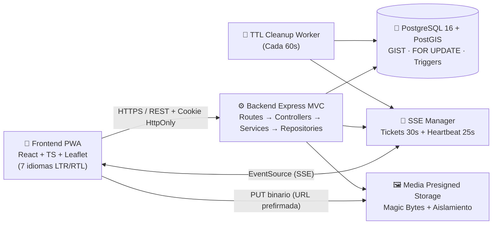

# 🪑 ReMueble · Rescate Urbano de Muebles

[](https://github.com/SinMasGato/geo-recogida-muebles/actions/workflows/ci.yml)
[](https://www.typescriptlang.org/)
[](https://nodejs.org/)
[](https://react.dev/)
[](https://postgis.net/)
[](./LICENSE)

Aplicación **Full-Stack Geoespacial (PWA Mobile-First)** diseñada para reportar, localizar y rescatar muebles y objetos depositados junto a contenedores urbanos en tiempo real.

Pensada para el uso real en la calle con una sola mano y cobertura móvil variable, combina un motor espacial **PostGIS**, sincronización en vivo mediante **Server-Sent Events (SSE)** e interfaz inclusiva en **7 idiomas** (incluyendo soporte nativo `RTL`).

---

## ✨ Características principales

- **🗺️ Motor Geoespacial PostGIS:** Búsquedas por radio (`ST_DWithin`) y por área visible del mapa (`bbox` con `ST_MakeEnvelope`) aceleradas mediante índices espaciales `GIST` y columnas `GEOGRAPHY(Point, 4326)`.
- **⚡ Tiempo real resiliente a redes 4G/5G (SSE):** Actualización instantánea de pines creados, reservados o recogidos mediante tickets opacos de un solo uso (30s), latidos (*heartbeats*) cada 25s y resincronización automática al desbloquear el teléfono (`visibilitychange`).
- **🔒 Reserva atómica sin condiciones de carrera:** Transacciones PostgreSQL con bloqueo de fila (`SELECT ... FOR UPDATE`) que impiden dobles reservas simultáneas y aplican el límite máximo de reservas activas por usuario.
- **📱 Experiencia Mobile-First e Inclusiva (7 idiomas):**
  - Interfaz en pantalla completa (`100dvh`), *Bottom Sheets*, mira central de precisión para contenedores y botón directo **«Cómo llegar»** (ruta a pie en Google Maps).
  - Soporte en **Español, Català, Français, العربية (`RTL`), Română, English y اردو (`RTL`)**, reforzado con iconografía universal por categoría.
- **📸 Cámara móvil y privacidad de imágenes:** Compresión automática en el navegador del teléfono (`Canvas` a WebP/JPEG ~250 KB) que elimina metadatos EXIF antes de subir a URLs prefirmadas de un solo uso con validación binaria de *Magic Bytes*.
- **🧹 Ciclo de vida automático (Worker TTL):** Proceso en segundo plano que libera reservas vencidas (2h), expira pines antiguos (24h), purga sesiones obsoletas y notifica los cambios por SSE.

---

## 🏗️ Arquitectura



---

## 🛡️ Seguridad implementada

- **Autenticación de doble token:** *Access Token* JWT de vida corta almacenado únicamente en memoria RAM (sin `localStorage`) + *Refresh Token* opaco rotativo en cookie `HttpOnly`, `SameSite=Strict`, cifrado con `HMAC-SHA256` (*pepper*) y **detección de robo/reutilización por familia de sesiones**.
- **Protección contra enumeración y fuerza bruta:** Comparación en tiempo constante con *dummy hash* `bcrypt` (12 rondas) y doble *Rate Limiting* (por IP en autenticación y por `userId` en escrituras para compatibilidad con redes móviles **CGNAT**).
- **Defensa en profundidad:** Validación estricta con **Zod** (`.strict()` contra *Mass Assignment*), cabeceras **Helmet** con CSP configurada para OpenStreetMap, restricciones `CHECK` en PostgreSQL y tabla inmutable `audit_logs`.
- **Anti-spam y privacidad espacial:** Deduplicación de pines del mismo usuario en un radio de 15 metros (10 min), redondeo de coordenadas a 5 decimales (~1,1 m) y validación de *Magic Bytes* + protección *Path Traversal* en subida de fotos.

---

## 🛠️ Stack tecnológico

| Capa | Tecnologías |
| :--- | :--- |
| **Backend** | Node.js, TypeScript (`strict`), Express 4 (MVC desacoplado), Zod, JWT, `bcryptjs`, Helmet, `express-rate-limit` |
| **Base de Datos** | PostgreSQL 16 + PostGIS 3.4 (Docker Compose) |
| **Frontend** | React 18, TypeScript, Vite 5, Leaflet (OpenStreetMap), CSS *Mobile-First* (`100dvh`, `env(safe-area-inset-*)`) |
| **DevOps / Calidad** | Docker Compose, GitHub Actions CI, Conventional Commits, EditorConfig |

---

## 🚀 Puesta en marcha local

### Prerrequisitos
- **Node.js 20+** (recomendado 22 LTS)
- **Docker Desktop** con soporte WSL 2 / Docker Compose

### 1. Clonar el repositorio y configurar variables de entorno
```bash
git clone [https://github.com/SinMasGato/geo-recogida-muebles.git](https://github.com/SinMasGato/geo-recogida-muebles.git)
cd geo-recogida-muebles
cp .env.example .env
```
*(En Windows PowerShell usa `copy .env.example .env` y revisa las claves JWT en `.env` si vas a desplegarlo).*

### 2. Levantar PostgreSQL + PostGIS
```bash
docker compose up -d
```
El script `backend/database/init.sql` creará automáticamente las extensiones `postgis` y `pgcrypto`, tablas, índices `GIST`, restricciones `CHECK` y *triggers*.

### 3. Iniciar el Backend (Terminal 1)
```bash
cd backend
npm install
npm run dev
```
Disponible en `http://localhost:4000` (healthcheck en `GET /api/health`).

### 4. Iniciar el Frontend PWA (Terminal 2)
```bash
cd frontend
npm install
npm run dev
```
Abre `http://localhost:5173` en tu navegador (puedes activar la vista móvil con `F12` → `Ctrl + Shift + M`). El proxy de Vite redirige automáticamente `/api` y `/uploads` hacia el backend manteniendo el mismo origen para las cookies `HttpOnly`.

---

## 📡 Endpoints principales de la API

| Método | Ruta | Descripción | Auth |
| :--- | :--- | :--- | :---: |
| `GET` | `/api/health` | Estado del servicio | No |
| `POST` | `/api/auth/register` | Registro de usuario + emisión de cookie `HttpOnly` | No |
| `POST` | `/api/auth/login` | Inicio de sesión | No |
| `POST` | `/api/auth/refresh` | Rotación atómica de *Refresh Token* | Cookie |
| `POST` | `/api/auth/logout` | Revocación de sesión y limpieza de cookie | Cookie |
| `GET` | `/api/auth/me` | Perfil del usuario autenticado | Bearer |
| `POST` | `/api/events/ticket` | Emite ticket opaco de un solo uso (30s) para SSE | Bearer |
| `GET` | `/api/events/stream?ticket=...` | Canal de eventos en tiempo real (`pin:created/updated/deleted`) | Ticket |
| `POST` | `/api/media/presign` | Genera URL prefirmada de subida (120s) | Bearer |
| `PUT` | `/api/media/upload/:token` | Subida binaria con inspección de *Magic Bytes* | Token |
| `GET` | `/api/pins` | Búsqueda espacial por radio (`lat,lng,radius`) o `bbox` | Bearer |
| `GET` | `/api/pins/:id` | Detalle completo de un objeto | Bearer |
| `POST` | `/api/pins` | Publicación rápida geoespacial | Bearer |
| `POST` | `/api/pins/:id/reserve` | Reserva atómica por 2 horas | Bearer |
| `POST` | `/api/pins/:id/release` | Liberación de reserva activa | Bearer |
| `POST` | `/api/pins/:id/collect` | Confirmación de recogida | Bearer |
| `DELETE` | `/api/pins/:id` | Eliminación por el autor (si sigue disponible) o admin | Bearer |

---

## 📂 Estructura del proyecto

```text
geo-recogida-muebles/
├── .github/
│   ├── workflows/ci.yml            # Integración Continua (typecheck + build)
│   └── PULL_REQUEST_TEMPLATE.md
├── backend/
│   ├── database/init.sql           # Esquema PostgreSQL + PostGIS + Triggers
│   └── src/
│       ├── config/                 # Validación Zod de env y pool pg
│       ├── middlewares/            # Helmet, CORS, Rate Limit, AuthN/AuthZ, Errores
│       ├── modules/
│       │   ├── audit/              # Registro inmutable de auditoría
│       │   ├── auth/               # JWT + rotación atómica de Refresh Tokens
│       │   ├── events/             # Gestor SSE con tickets y heartbeats
│       │   ├── media/              # URLs prefirmadas y Magic Bytes
│       │   └── pins/               # Motor geoespacial PostGIS y reservas
│       └── workers/                # Worker periódico de limpieza TTL
├── frontend/
│   ├── public/manifest.webmanifest # Manifiesto PWA instalable
│   └── src/
│       ├── components/             # AuthScreen, MapView, Bottom Sheets
│       ├── context/                # AuthContext con restauración silenciosa
│       ├── hooks/                  # usePinEvents (SSE resiliente)
│       ├── i18n/                   # 7 idiomas + soporte LTR/RTL + iconos
│       ├── services/               # Cliente API con refresh deduplicado
│       └── utils/                  # Compresor de fotos móvil sin EXIF
├── docker-compose.yml
├── .env.example
└── README.md
```

---

## 🗺️ Roadmap

- [x] Esquema PostGIS con índices `GIST`, restricciones `CHECK` y *triggers*.
- [x] Autenticación segura con rotación atómica y detección de reutilización.
- [x] Motor de búsqueda por radio y `bbox` + publicación rápida anti-spam.
- [x] Tiempo real SSE con reconexión móvil + *worker* TTL.
- [x] Frontend PWA Mobile-First en 7 idiomas (`LTR`/`RTL`) con Leaflet y compresión de cámara.
- [ ] Almacenamiento de imágenes en la nube (Cloudflare R2 / AWS S3).
- [ ] Tests de integración automatizados (Vitest + Supertest).
- [ ] Despliegue HTTPS en producción con proxy inverso y Service Worker offline.

---

## 📄 Licencia

Distribuido bajo licencia **MIT**. Consulta el archivo [LICENSE](./LICENSE) para más información.
